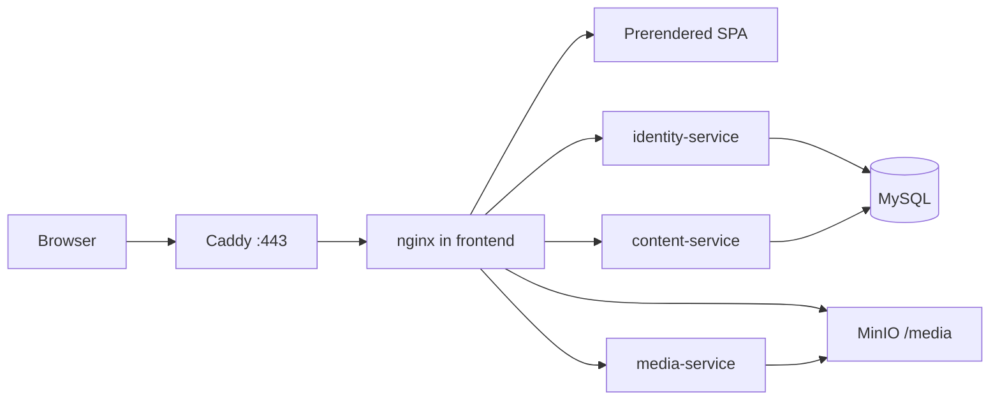
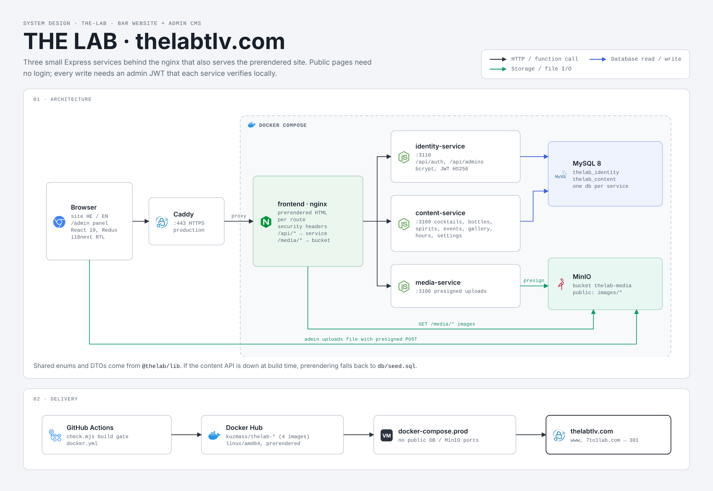

# THE LAB — thelabtlv.com

Website for **THE LAB by TYO**, an experimental cocktail bar at Ahad Ha'am 1, Neve Tzedek, Tel Aviv.
"Networking the experimental underground."

Public site (Hebrew / English), bottled-cocktail delivery showcase ("Take Me Home"), one-tap
reservations and delivery, and an admin panel so the team can edit the menu, prices, hours and events.

- Brand system: [docs/BRAND.md](docs/BRAND.md) (brand by Eliezer House, 2026)
- Content seed & business facts: [docs/CONTENT.md](docs/CONTENT.md)
- Architecture & decisions: [system_architecture.md](system_architecture.md)
- Launch checklist: [docs/LAUNCH_CHECKLIST.md](docs/LAUNCH_CHECKLIST.md)



In dev, skip Caddy and open nginx at http://localhost:8080.

Screenshots (Hebrew and English, desktop and mobile) are in [docs/screenshots](docs/screenshots). Regenerate them with the stack running:

```bash
node scripts/screenshots.mjs
```

## System design



## Tech stack

Node.js 24 · Express 5 · TypeScript · Joi · Sequelize + MySQL · MinIO ·
React 19 · Vite · Redux Toolkit · React Router 7 · React Hook Form · i18next · nginx · Docker Compose.

## Build gate

```bash
node scripts/check.mjs        # installs (if needed), builds, lints every package
```

## Frontend (dev)

```bash
cd frontend
npm install
npm run dev
```

Open http://localhost:5173. Hebrew is at `/` (`lang="he"` `dir="rtl"`). English is under `/en`.
In dev, http://localhost:5173/styleguide shows the brand tokens and primitives. It is omitted from production builds.

`npm run build:production` prerenders every public route into `dist/<path>/index.html`, then writes `dist/sitemap.xml` and `dist/robots.txt`. It needs Google Chrome. Set `SKIP_PRERENDER=1` to skip that browser step (the Node CI job does this). The frontend Docker image prerenders by default and falls back to `db/seed.sql` when the content API is down. Sitemap and robots are still written. Vite's preview server falls back to the SPA shell, so it hides those files. `node scripts/preview-static.mjs` serves them the way nginx will (`/menu` → `dist/menu/index.html`) and proxies `/api` to the content service.

Mobile Lighthouse reports for Home, Menu, Take Me Home and Visit live in `docs/lighthouse/`.

Accessibility check (not part of the build gate; needs Chrome):

```bash
cd frontend
npm run test:e2e
```

The dev server can already be running on port 5173. The suite runs axe-core on every public route in Hebrew and English, and on `/admin/login`, and fails on serious or critical violations.

## Content API (dev)

```bash
docker compose up -d database
cd content-service
npm install
npm run dev
```

MySQL is published on `localhost:3307` (root password `thelab` in the dev compose file). The content service listens on http://localhost:3109 and creates `thelab_content` on startup, seeding from `db/seed.sql` only while the cocktails table is empty. The identity service listens on http://localhost:3110, creates `thelab_identity`, and seeds the first owner only when `THELAB_ADMIN_EMAIL` and `THELAB_ADMIN_PASSWORD` are set and no admins exist.

Public reads: `/api/health`, `/api/cocktails`, `/api/cocktails/:code`, `/api/bottles`, `/api/spirits`, `/api/events`, `/api/gallery`, `/api/hours`, `/api/settings`.

```bash
cd identity-service
npm install
THELAB_ADMIN_EMAIL=owner@thelabtlv.com THELAB_ADMIN_PASSWORD=change-me-strong-password npm run dev
```

## Media uploads (dev)

```bash
docker compose up -d minio
cd media-service
npm install
npm run dev
```

MinIO is published on http://localhost:9200 (console http://localhost:9201). The media service listens on http://localhost:3106, creates the `thelab-media` bucket, and makes only `images/*` public. `POST /api/uploads/presign` and `DELETE /api/uploads` need an owner or editor JWT from the identity service.

## Full stack (Docker)

Copy `.env.example` to `.env` and set the passwords. `MYSQL_ROOT_PASSWORD` and `THELAB_DB_PASSWORD` must be the same. When `.env` does not set them, compose falls back to root password `thelab`, which is what an existing dev volume was initialized with.

```bash
docker compose up -d --build
```

The site is http://localhost:8080 (Hebrew at `/`, English at `/en`, admin at `/admin`). nginx proxies `/api/*` to the services and `/media/*` to the MinIO bucket. MySQL stays on `localhost:3307` and MinIO on `localhost:9200`. App containers are not published on the host.

Production compose does not publish the database or MinIO. Caddy terminates HTTPS for thelabtlv.com and redirects `www` and `7to1lab.com` to the apex.

```bash
docker compose -f docker-compose.prod.yaml config
```

## Publish images

Images are `kuzmass/thelab-frontend`, `kuzmass/thelab-identity-service`, `kuzmass/thelab-content-service`, and `kuzmass/thelab-media-service`, tag `latest`, platform `linux/amd64`. The frontend publish build prerenders (the dev compose build skips that, because it has no Chrome unless you ask):

```bash
docker buildx build --platform linux/amd64 -f identity-service/Dockerfile -t kuzmass/thelab-identity-service:latest --push .
docker buildx build --platform linux/amd64 -f content-service/Dockerfile -t kuzmass/thelab-content-service:latest --push .
docker buildx build --platform linux/amd64 -f media-service/Dockerfile -t kuzmass/thelab-media-service:latest --push .
docker buildx build --platform linux/amd64 -f frontend/Dockerfile --build-arg BUILD_SCRIPT=build:production --build-arg SKIP_PRERENDER=0 -t kuzmass/thelab-frontend:latest --push .
```

`.github/workflows/docker.yml` builds all four on pull requests and pushes on `main` only when `DOCKERHUB_USERNAME` and `DOCKERHUB_TOKEN` are set. The frontend image pushed from that workflow is the prerendered production build.

## Environment

Copy `.env.example` to `.env`. Compose reads it. Host `npm run dev` uses each service's `config/default.json` unless you export the variables yourself.

| Variable | Role |
| --- | --- |
| `MYSQL_ROOT_PASSWORD` | MySQL root password. Must match `THELAB_DB_PASSWORD`. |
| `THELAB_DB_HOST` | `database` inside compose, `localhost` for a service on the host. |
| `THELAB_DB_PASSWORD` | Password the services use for MySQL. |
| `THELAB_JWT_SECRET` | Shared HS256 secret. Production refuses the default and anything shorter than 32 characters. |
| `THELAB_ADMIN_EMAIL` / `THELAB_ADMIN_PASSWORD` | First owner, created only when the admins table is empty. |
| `MINIO_ROOT_USER` / `MINIO_ROOT_PASSWORD` | MinIO root credentials. |
| `THELAB_S3_ENDPOINT` | Where media-service talks to MinIO (`http://minio:9000` in compose). |
| `THELAB_S3_PUBLIC_ENDPOINT` | Where the browser uploads (`http://localhost:9200` in dev). |
| `THELAB_S3_PUBLIC_BASE_URL` | Public image origin (`http://localhost:8080/media` in dev, `https://thelabtlv.com/media` in production). |
| `THELAB_CORS_ORIGINS` | Comma-separated origins allowed to call the APIs. |
| `THELAB_SITE_URL` | Public site origin used by sitemap generation. |

## How staff update the menu

1. Open `/admin` and sign in.
2. Cocktails, bottles, spirits, events, and the archive each have a list. Add or edit a row, then save. Prices are whole shekels.
3. Photos: the form asks media-service for a presigned upload, the browser posts the file to MinIO, and the record stores the `/media/...` URL plus Hebrew and English alt text.
4. Hours and the booking, delivery, and gift-card links live under Hours and Settings.
5. Owners can add another admin under Managers. Editors can change content and cannot manage admins.
6. Sign out when you leave the machine. Change the password under Account.
